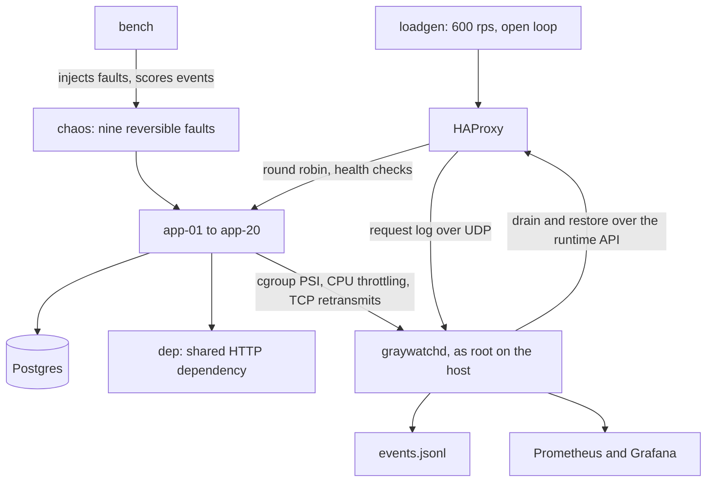
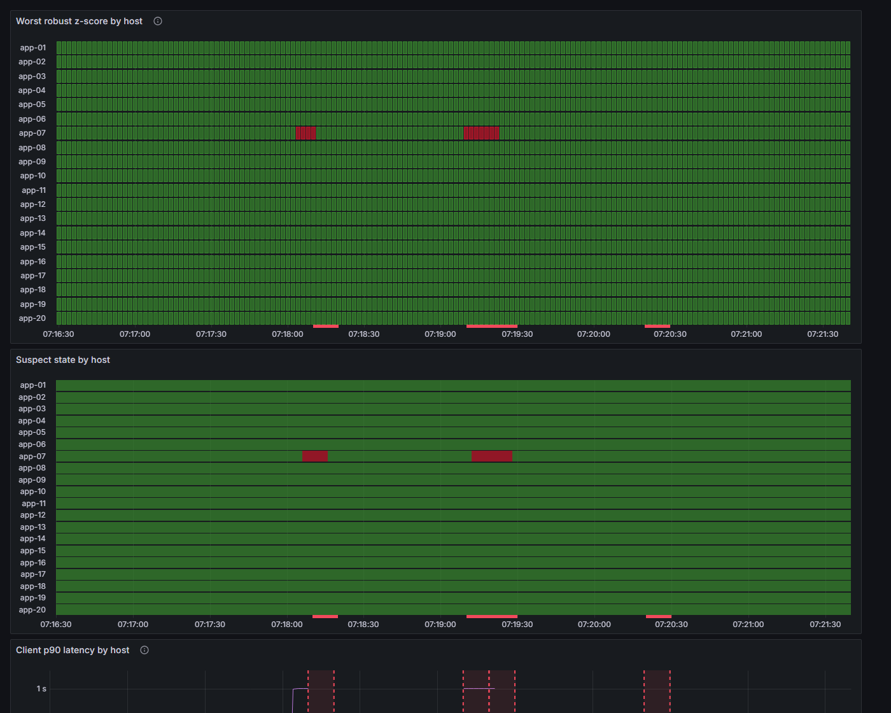

# Graywatch

Graywatch finds containers that pass their health checks while failing real traffic, takes them out of the load balancer, and measures how well that worked with a fault-injection benchmark.

## The problem

> **TODO: one sentence, in your own words, about the connection-pool incident from your internship.**

A health endpoint that returns 200 says the process is up and little else. This kind of partial failure is called a gray failure: the host looks fine to the load balancer while its requests fail or crawl. A deeper health check helps only with what it was written to test.

Graywatch compares each host against the rest of the fleet instead. A host whose latency, errors or kernel pressure stand out from its peers gets flagged, whatever its health endpoint says.

## How it works



Every second, `graywatchd` reads seven signals per host: p90 latency and error rate from HAProxy's request log, CPU, IO and memory pressure from cgroup PSI, CPU throttling, and TCP retransmits from the container's network namespace.

It scores each signal with a robust z-score against the other hosts, and a host becomes suspect when it is flagged in 3 of the last 5 ticks. Because hosts are compared with each other, a problem shared by every host doesn't single anyone out. So the fleet's median latency and error rate have their own limits, and breaching one raises a fleet alert and blocks drains and restores.

Drains go through HAProxy's runtime API with limits on how much damage they can do. At most 10% of the fleet can be out of rotation at once, whoever took it out, including hosts failing their health checks. Nothing drains while more than 30% of hosts are suspect or down, or in the first 20 s after traffic starts. Actions are at least 10 s apart, a host waits out a 60 s cooldown before coming back, and a host drained 3 times in 10 minutes stays out and raises an alert.

## Results

Each fault ran three times in each of three configs on one VM with 20 hosts at 600 rps. HC is HAProxy's health check, and TTD is the time from injecting the fault to Graywatch flagging it.

| Fault | HC caught (shallow) | HC caught (deep) | Graywatch caught | Median TTD | Category right | False-positive hosts | p99 detect-only | p99 remediate |
|---|---|---|---|---|---|---|---|---|
| cpu-contention | 0/3 | 0/3 | 9/9 | 3.0 s | 9/9 | 0 | 239 ms | 55 ms |
| cpu-throttle | 0/3 | 3/3 | 9/9 | 3.0 s | 9/9 | 0 | 2000 ms | 27 ms |
| dep-slow | 0/3 | 0/3 | 9/9 | 2.9 s | n/a | 0 | 632 ms | 637 ms |
| dns-break | 0/3 | 3/3 | 9/9 | 6.0 s | 9/9 | 0 | 1004 ms | 32 ms |
| io-throttle | 0/3 | 0/3 | 9/9 | 3.0 s | 9/9 | 1 | 2001 ms | 27 ms |
| mem-pressure | 3/3 | 3/3 | 9/9 | 3.0 s | 9/9 | 0 | 34 ms | 31 ms |
| net-delay | 0/3 | 0/3 | 9/9 | 3.0 s | 0/9 | 0 | 431 ms | 27 ms |
| net-loss | 0/3 | 0/3 | 9/9 | 3.0 s | 8/9 | 0 | 39 ms | 24 ms |
| pool-leak | 0/3 | 3/3 | 9/9 | 3.0 s | 9/9 | 0 | 1003 ms | 26 ms |

With no fault running on a warmed-up fleet, no host was flagged in 11 host-hours. That's a small sample: it fits a true rate of up to about 0.27 per host-hour, or about 5 false suspects an hour across 20 hosts. For `dep-slow`, a shared dependency problem, "caught" means a fleet alert, and Graywatch drained nothing in any of the nine trials.

Deep health checks do better than this table might suggest. On `pool-leak` and `dns-break` they end up with fewer errors than Graywatch's drains, about 0.48% against 0.73%, even though they react 6 to 7 s later. A drained host gets no traffic, so it reads as healthy and comes back after the cooldown with the fault still on, then fails requests for about 10 s until it is drained again. Graywatch's clearer advantage is on faults that deep checks can't see, such as `io-throttle`, `net-loss` and `cpu-contention`.

[docs/RESULTS.md](docs/RESULTS.md) has the error rates and how to read the numbers, and [docs/data/trials.csv](docs/data/trials.csv) has every trial.

This is one `pool-leak` on `app-07` with real drains. The fault starts at 07:18:01. The second red block is the host coming back after its cooldown with the fault still on, and being drained again.



## Running it

You need a Linux VM with cgroup v2, Docker, Go 1.25 or newer, `tc`, `nsenter` and `socat`. I used an Azure `Standard_D4ds_v4` (4 vCPU, 16 GiB) on Ubuntu 24.04.

The fleet does one synced write per request, so 600 rps is at least 600 writes a second. Put the repo on a disk that can take it. The VM's local SSD worked, and I avoided Azure's 128 GiB Premium SSD because its baseline is 500 IOPS. A full benchmark also writes about 35 GB.

Check the machine, then start the fleet:

```bash
sudo scripts/vm-setup.sh
```

```bash
go run ./cmd/fleetgen -n 20 -out deploy
```

```bash
docker compose -f deploy/docker-compose.yml up -d --build --force-recreate
```

Keep `--force-recreate` when you restart the fleet. HAProxy resolves server names only when it starts, so recreating the apps without it sends each server's traffic to the wrong container, and every server still reads `UP`.

Build the tools, then start some load and the daemon. Leave out `-dry-run` to let the daemon really drain hosts:

```bash
go build -o bin/ ./cmd/...
```

```bash
bin/loadgen -rps 600 -duration 5m
```

```bash
sudo bin/graywatchd -dry-run -events events.jsonl
```

Break a host and watch `events.jsonl`:

```bash
sudo bin/chaos apply -fault pool-leak -host app-07
```

```bash
sudo bin/chaos revert -fault pool-leak -host app-07
```

Run the full benchmark, which takes about 4 hours, and generate the report, which replaces `docs/RESULTS.md`. Stop your own `graywatchd` and `loadgen` first, since the benchmark starts its own. It refuses to overwrite earlier results unless you pass `-force`:

```bash
sudo bin/bench run -graywatchd "$PWD/bin/graywatchd" -out results/run1
```

```bash
bin/bench report results/run1
```

The dashboard is off by default, because the benchmark's numbers come from a fleet without it. It listens on `localhost:3000` on the VM, so reach it through an SSH tunnel:

```bash
docker compose -f deploy/docker-compose.yml --profile dashboard up -d
```

Keep ports 5140 (UDP) and 9100 firewalled from anything outside the VM. `graywatchd` runs as root and trusts the request log it receives on 5140, so anyone who can reach that port can forge log lines and get healthy hosts drained, up to the 10% limit, or raise a fleet alert that blocks drains. Port 9100 serves its metrics with no authentication.

## Limitations

- The containers share one kernel and one disk, so this simulates a fleet. A fault on one host can reach its neighbours through shared resources in ways separate machines wouldn't. Writes limited hard enough slowed other hosts, and reverting `io-throttle` on an undrained host slowed the whole fleet for several seconds.
- Network delay is diagnosed as `app`. Delay alone causes no retransmits, and without round-trip data a slow network looks like a slow application. Graywatch still detects and drains the host, but the label is wrong in all nine trials.
- HAProxy's logs are the only client view. Graywatch can't see what clients on other paths experience.
- A host's first requests are slow, up to about 1 s for the first 2 s of traffic, so healthy hosts can go suspect when traffic starts. That really drained a healthy host once, so drains now wait 20 s after traffic starts (`-startup-grace`), and a held drain is logged as `drain_held`. The cost is that a daemon restarted during a real failure can't drain anything for 20 s. Those suspect events can still appear, and the benchmark warms up first, so its false positive numbers don't cover them.
- Graywatch can't tell its own drains from yours after a restart. Any server in maintenance when the daemon starts is treated as drained by Graywatch, and comes back 60 s later if it reads healthy. Don't run the daemon on a fleet with servers you've taken out by hand. A server you take out while it's running is left alone, and counts toward the 10% limit.
- Three trials per config is few. These are direct comparisons on one machine, not precise estimates.
- `mem-pressure` at this strength nearly stalls the host, so it isn't really gray, and even the shallow check catches it in about 13 s. Its results also come from a separate run on a fresh fleet, after fixing a bug that made the fault do nothing on long-running hosts.

## What I'd do next

- Add a run queue latency signal with eBPF, per cgroup, to measure CPU contention directly.
- Add round-trip data, so `net-delay` gets the right category.
- Test a drained host with a little traffic before fully restoring it, which should remove most of the errors from restoring a host too early.
